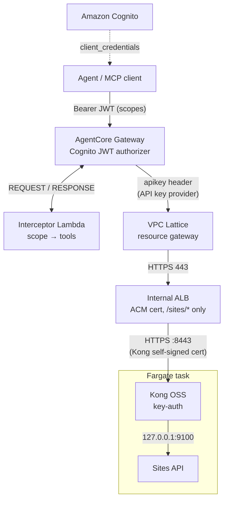
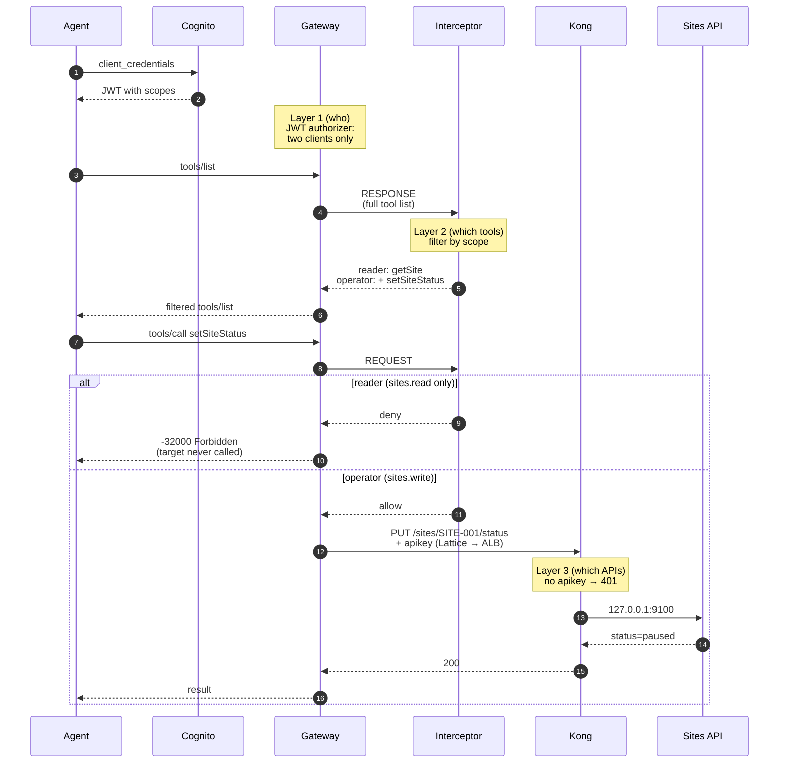

# Per-agent tool access for Kong-protected APIs with Amazon Bedrock AgentCore Gateway

> **Note:** This is sample code, for non-production usage. Work with your security and legal teams to meet your organizational requirements before deployment.

One REST API behind Kong OSS `key-auth`, exposed to agents as MCP tools through an
[Amazon Bedrock AgentCore Gateway](https://docs.aws.amazon.com/bedrock-agentcore/latest/devguide/gateway.html)
OpenAPI target that reaches Kong **privately**. Two agents share the gateway but see and call different tools:

| Caller (Cognito M2M) | Scopes | Sees / may call |
|---|---|---|
| `reader` | `sites.read` | `getSite` |
| `operator` | `sites.read sites.write` | `getSite`, `setSiteStatus` |

Three layers, each answering one question:

1. **IdP scopes — who.** Cognito issues client-credentials tokens; the Gateway's JWT authorizer accepts only these two clients.
2. **Gateway interceptor — which tools.** One Lambda at REQUEST + RESPONSE filters `tools/list` (and semantic-search
   results) and answers a disallowed `tools/call` with JSON-RPC `-32000 Forbidden` before the target is ever called. Fail closed.
3. **Kong key-auth — which APIs.** The Gateway injects an `apikey` header from an AgentCore Identity API key provider;
   Kong rejects anything without it.



Where each layer decides, for the same two calls made by both agents (the four demo steps):



Everything is one CDK stack and one `cdk deploy` (`lib/stack.ts`, `aws-cdk-lib` 2.273.0 `aws-bedrockagentcore` L2s);
no boto3 scripts. L1 touches: `privateEndpoint.managedVpcResource` on the target (no L2 prop yet), one property
override (see Gotchas), and `AWS::Logs::Delivery*` for the Gateway's application logs.

## Repo

```
bin/app.ts               App + cdk-nag AwsSolutionsChecks
lib/stack.ts             Cognito, Kong + API on Fargate, internal ALB + cert + DNS, interceptor, Gateway, API key provider, target
test/stack.test.ts       Template assertions + cdk-nag zero findings
interceptor/handler.py   The interceptor (stdlib only) + test_handler.py
api/server.py            Synthetic Sites API (stdlib)  +  api/openapi.json (getSite, setSiteStatus)
kong/kong.yaml           Kong DB-less config: /sites + key-auth
demo/demo.sh             Self-explaining 4-step demo  +  client.py (minimal MCP client)
```

## Prerequisites

- An AWS account you can deploy to (dev/sandbox), CDK-bootstrapped (`npx cdk bootstrap`), with a **default VPC**.
- A **public Route 53 hosted zone**. The internal ALB gets a public ACM certificate and an alias record in it —
  AgentCore Gateway requires an `https` server URL with a publicly trusted certificate.
- Node.js 22+, Python 3.12+, AWS CLI v2. No Docker needed (images are pulled from Docker Hub by ECS, pinned by digest).
  The steps below call `python3.12` explicitly: on Amazon Linux 2023 `python3` is 3.9, which can't install the pinned
  demo and test dependencies (`sudo dnf install -y python3.12` if it's missing).

## Deploy (~10 min)

```bash
npm ci && npm test                       # tsc + jest + cdk-nag
python3.12 -m venv .venv && .venv/bin/pip install -r demo/requirements.txt pytest==9.2.0
.venv/bin/python -m pytest interceptor -q
npx cdk deploy --require-approval never \
  -c domainName=kta-api.example.com -c hostedZoneId=Z0123456789ABC -c hostedZoneName=example.com
```

Named resources are prefixed `kta`; the ALB's name is generated by CloudFormation so it can be replaced in place. The longest step is the Gateway target (~5 min) while AgentCore creates the
VPC Lattice resource gateway in your subnets.

Cost: about $0.07/hour while deployed (≈ $51/month left running). Most of it is Fargate, the ALB and Container Insights. See [costs.md](costs.md).

## Demo

```bash
PYTHON=.venv/bin/python ./demo/demo.sh
```

Output from a live run (client ids replaced):

```
Callers (client-credentials tokens decoded locally, never printed)
  reader    <reader-client-id>     kta-api/sites.read
  operator  <operator-client-id>   kta-api/sites.read kta-api/sites.write

1. reader -> tools/list
  Got      kta-sites___getSite
  Log      interceptor: tools/list filtered 2 -> 1                       PASS
2. operator -> tools/list
  Got      kta-sites___getSite kta-sites___setSiteStatus
  Log      interceptor: tools/list filtered 2 -> 2                       PASS
3. reader -> tools/call kta-sites___setSiteStatus (a tool it was never shown)
  Got      {"error": {"code": -32000, "message": "Forbidden: tool 'kta-sites___setSiteStatus' is not permitted for this caller"}}
  Log      interceptor: decision=deny tool=kta-sites___setSiteStatus     PASS
4. operator -> tools/call kta-sites___setSiteStatus
  Call     {"siteId":"SITE-001","status":"paused"}  (getSite before: status=active)
  Path     Gateway -> VPC Lattice -> internal ALB -> Kong key-auth -> API
  Got      {"result": {"siteId": "SITE-001", "name": "Example Site A", "status": "paused"}}
  Log      interceptor: decision=allow tool=kta-sites___setSiteStatus    PASS

  4/4 PASS
```

Kong's access log (`/kta/kong`) shows exactly one `PUT /sites/SITE-001/status` — step 4's. Step 3 never left the Gateway.

## Cleanup (~7 min)

```bash
npx cdk destroy --force -c domainName=kta-api.example.com -c hostedZoneId=Z0123456789ABC -c hostedZoneName=example.com
```

CloudFormation deletes the target first (it depends on the ALB, service, DNS and security groups); AgentCore removes the
managed resource gateway with it, so the security groups delete cleanly. The Kong secret is deleted without a recovery
window, and the KMS key is scheduled for deletion with a 7-day waiting period. Two things stay behind:

- ACM's `_<hash>.<domainName>` validation CNAME in your hosted zone. Delete it by hand if you won't redeploy.
- The log group ECS creates for Container Insights, outside the stack:

  ```bash
  aws logs delete-log-group --log-group-name /aws/ecs/containerinsights/kta-cluster/performance
  ```

## Security notes

- **Decode, not verify.** The interceptor only base64-decodes the JWT to read `scope`. That is safe because the Gateway's
  `CUSTOM_JWT` authorizer has already validated signature, issuer, expiry and client before the interceptor runs, and the
  stack grants `lambda:InvokeFunction` only to the Gateway role. Another principal in the account with broad Lambda
  permissions could still invoke the function directly, but would get back only a filtered list or an error, never a path
  to the API, because only the Gateway holds Kong's key. If you change the inbound auth or invoke it elsewhere, add JWKS
  verification.
- **Fail closed.** No token, bad token, unknown scope, unknown tool, malformed policy, a batched (JSON array) request, a
  malformed `tools/list` or search response, or any exception → hidden/denied (each case is unit-tested in
  `interceptor/test_handler.py`). Tokens are never logged; the demo prints decoded scopes only.
- **Private path.** The ALB is internal and accepts 443 only from the resource-gateway security group; it forwards only
  `/sites/*`, over HTTPS to Kong on 8443, so the `apikey` header is never sent in plaintext. Kong serves the self-signed
  certificate it generates at startup. ALB doesn't validate target certificates (of any issuer), and AWS documents that
  traffic between an ALB and its targets inside a VPC is authenticated at the packet level, so it isn't open to spoofing
  or man-in-the-middle attacks even with a self-signed certificate. Kong's Admin API is off, and the API binds to
  `127.0.0.1` inside the task.
- **Public IP on the task (demo trade-off).** The Fargate task has a public IP only so it can pull the Kong and Python
  images from Docker Hub in a default VPC without a NAT gateway. Its security group accepts inbound traffic only from the
  ALB's security group, on 8443, so nothing on the internet can reach Kong or the API. Outbound is limited to TCP 443, which image pulls, Secrets
  Manager and CloudWatch Logs need. For production, run the task in private subnets and pull images from Amazon ECR
  through VPC endpoints, so egress can be limited to those endpoints.
- **Secrets.** The Kong key is generated into Secrets Manager, injected into Kong by ECS, and fed to the API key provider by a
  CloudFormation dynamic reference — never in the repo or the template. Kong refuses to start without it. Inside the
  container the key is spliced into Kong's config with shell builtins (never in a process argument list) and written
  to a `0600` file in `/tmp`.
- **Least privilege.** Gateway role grants come from the L2 (`lambda:InvokeFunction` on the interceptor; workload identity,
  API key and the provider-managed secret, each name-scoped). cdk-nag `AwsSolutions` passes with resource-scoped suppressions.
- **Encryption at rest.** One customer managed AWS KMS key, with automatic rotation, encrypts the Kong secret, all three
  log groups and the interceptor's environment variables. Its key policy replaces CDK's default (`kms:*` for the account)
  and names every action. Account administrators can manage and delete the key through IAM but can't use it directly.
  Only these can use it: CloudWatch Logs for this stack's three log groups, Secrets Manager for the Kong secret, Lambda
  for function environments in this account, and the interceptor's role to read its own environment. A unit test fails
  if any IAM or key policy statement in the template uses a wildcard action.
- **Scanner exceptions.** Each Checkov skip and cdk-nag suppression sits next to its resource in `lib/stack.ts`, with the
  reason: no ALB access logs (internal, single route, every request logged downstream), and no dead-letter queue, VPC or
  reserved concurrency for the interceptor (synchronous, no network calls, quota-safe). A unit test fails if a skip has
  no reason.
- **Tokens and client secrets.** Access tokens last 15 minutes, not Cognito's 60-minute default. Any principal allowed
  `cognito-idp:DescribeUserPoolClient` on the pool can read the clients' secrets; that's how `demo/demo.sh` gets them.
  For production, deny that action to everyone except your deployment role, and give each agent its client secret
  through Secrets Manager.
- **One control decides tool access.** The Gateway's JWT authorizer checks which client is calling, not its scopes, and
  Kong accepts every Gateway call with one key, so the interceptor is the only per-tool check. Anyone who can detach it
  or edit its `TOOL_POLICY` can widen access. For production, allow only your deployment pipeline to update the Gateway,
  its targets and the interceptor function (for example `lambda:UpdateFunctionConfiguration` and
  `lambda:UpdateFunctionCode`), and alert on those changes in AWS CloudTrail. If you want a second, declarative check,
  add a rule on the same scopes in Policy in Amazon Bedrock AgentCore.
- **Caller identity below the Gateway.** Kong and the API see every request as one consumer, `agentcore-gateway`, so
  they can't tell callers apart. Per-caller attribution lives at the Gateway: the interceptor logs the caller, the tool
  and the decision for every `tools/call`. For production, keep those logs, and the Gateway's, longer than this demo's
  one week.
- **Prompt injection on write tools.** The operator is allowed to call `setSiteStatus`, so an agent that holds the
  operator token and is manipulated by prompt injection can still write. This sample doesn't defend against prompt
  injection. For production, grant write scopes only to the agents that need them, and require human approval for
  write tools in the agent.
- This is a demo: dev removal policies, one Fargate task, no per-caller rate limiting, no WAF, one-week log retention,
  no automated rotation of the Kong key, writable container filesystems, and no Lambda tracing.
- **Scanning.** `package.json` `overrides` pin patched `glob`/`minimatch` for the dev toolchain; `.ash/.ash.yaml`
  documents the one accepted advisory (minimatch bundled inside `aws-cdk-lib`, synth-time only) with an expiry.
  ASH's npm-audit and grype scanners read `node_modules/` too, so those suppressions are path-scoped to it.

## Gotchas

- OpenAPI targets **don't support spec-level `securitySchemes`/`security`**. `api/openapi.json` documents Kong's `apikey`
  header; the stack strips it and configures outbound auth on the target instead.
- The API key header is sent as `<prefix><key>`; the L2 default prefix is `Bearer `. Kong wants the raw key, and
  CloudFormation rejects an empty prefix, so the stack removes the property.
- Target failures reach the agent only as *"An internal error occurred"*. The stack enables the Gateway's
  `APPLICATION_LOGS` (`/aws/vendedlogs/bedrock-agentcore/kta-gw`), where the real error appears.
- ALB, Fargate task and resource gateway use the **same two subnets** — ALB targets in an AZ the ALB doesn't cover never get traffic.
- `GetResourceApiKey` is evaluated against the Gateway's workload identity too, not only the provider; the L2's grants cover both.

## Learn more

- [Apply fine-grained access control with Bedrock AgentCore Gateway interceptors](https://aws.amazon.com/blogs/machine-learning/apply-fine-grained-access-control-with-bedrock-agentcore-gateway-interceptors/) (AWS ML blog)
- [Configuring Amazon Bedrock AgentCore Gateway for secure access to private resources](https://aws.amazon.com/blogs/machine-learning/configuring-amazon-bedrock-agentcore-gateway-for-secure-access-to-private-resources/) (AWS ML blog)
- Kong-native alternative: Kong AI Gateway's [AI MCP Proxy plugin](https://developer.konghq.com/plugins/ai-mcp-proxy/) supports
  [per-tool ACLs by consumer group](https://developer.konghq.com/plugins/ai-mcp-proxy/examples/conversion-listener-acl/)
  (AI Gateway Enterprise, Kong Gateway 3.12 or later, or Konnect).

## Contributing

See [CONTRIBUTING.md](CONTRIBUTING.md).

## Security

See [CONTRIBUTING](CONTRIBUTING.md#security-issue-notifications) and [SECURITY.md](SECURITY.md) to report a security issue.

## License

This library is licensed under the MIT-0 License. See the [LICENSE](LICENSE) file.
